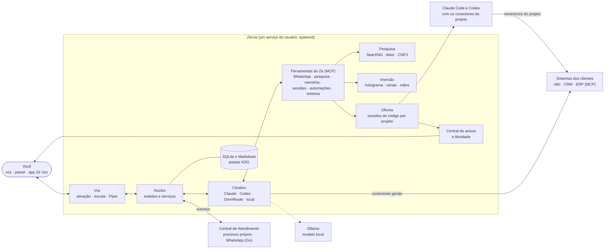

<div align="center">
  
  <h1>Zérvis</h1>
  <p><strong>O assistente de voz que trabalha com você: atende o seu WhatsApp, pesquisa empresas,<br>conduz agentes de código e mostra tudo em holograma, no seu Linux.</strong></p>
  <p>Você fala; o Zé faz, pergunta antes do que tem efeito e avisa quando termina.<br>Com o Claude, o Codex ou um modelo que roda no seu próprio computador.</p>
  <p>
    <a href="#um-dia-com-o-zé">Um dia com o Zé</a> ·
    <a href="#o-que-o-zé-faz">O que faz</a> ·
    <a href="#instalar-no-pc">Instalar no PC</a> ·
    <a href="docs/vps.md">Instalar numa VPS</a> ·
    <a href="#arquitetura">Arquitetura</a> ·
    <a href="docs/roteiro.md">Roteiro</a> ·
    <a href="CONTRIBUTING.md">Contribuir</a>
  </p>
  <p>
    <a href="LICENSE"></a>
    <a href="https://github.com/gestordescomplicaa-web/zervis/actions/workflows/check.yml"></a>
    
    
  </p>
</div>

> **Em desenvolvimento ativo, usado todo dia por quem o constrói.** O que está pronto e o que
> está em validação vem marcado em cada função; cada decisão tem o seu registro em
> [docs/adr](docs/adr/).

## Para quem é

Para **gestores e consultores de automação e IA**: quem atende clientes pelo WhatsApp, monta
integrações, fluxos e agentes para empresas, e quer um assistente que faça o trabalho pesado sem
misturar um cliente com outro. Serve também a quem só quer um assistente de voz de trabalho no
próprio Linux, com as mãos livres.

## Um dia com o Zé

Tudo isto é pela voz: no microfone do PC, no navegador ou no celular bloqueado, pelo app Zé Voz.

| Você diz | O Zé faz |
|---|---|
| "Quem me mandou mensagem?" · "O que a Ana falou do orçamento?" | Lê a caixa de entrada e o arquivo do seu WhatsApp, inclusive grupos, e responde curto: quem, quando e o quê. |
| "Responde a Ana: amanhã às 10 eu ligo." | Lê o destinatário e o texto, espera o seu "sim" e envia. Quando ela responder, ele avisa. |
| "Pesquisa a fundo os concorrentes da loja X." | Busca de vários jeitos, lê as melhores páginas e responde com as fontes e as datas. A pesquisa fica guardada. |
| "Qual o CNPJ dela e quem são os sócios?" | Consulta o cadastro da Receita e responde. |
| "Manda um oi para essa empresa no WhatsApp." | Pergunta "é para a Empresa X mesmo, no número tal?" e, com o seu sim, começa a conversa. |
| "Qual post meu teve mais visualização este mês?" | Lê as métricas do seu Instagram, só leitura, e diz qual, quando e por quê provável. |
| "Abre uma sessão no projeto do site e corrige o formulário." | Põe o Claude Code ou o Codex para trabalhar numa cópia isolada, narra o andamento e pede a sua aprovação. |
| "Cria um fluxo no n8n que salva os leads numa planilha." | Monta pelo MCP do n8n do cliente, testa com dados de exemplo e só publica com o seu ok. |
| "Me explica como funciona um RAG." · "Quem é fulano?" | Na Imersão, monta uma cena com gráficos, hologramas 3D, mapas e a foto real, com crédito. |
| "Muda para o local." | Passa a responder por um modelo no seu próprio computador, sem gastar os planos. |
| "Me lembra às 15h de mandar a proposta." | Agenda e avisa na hora, falando. |

## O que o Zé faz

### Voz em todo lugar
| Função | Estado |
|---|---|
| **"Ei Zé"** treinado com a sua voz, conversa contínua, interrupção no meio da fala e fim de turno pela entonação. Voz própria (Piper, primeiro som em cerca de 150 ms) ou da nuvem (ElevenLabs, Fish Audio), com a local de reserva. | Pronto |
| **Três modos**: Silencioso, Normal ("Ei Zé") e Live, uma conversa contínua como uma ligação. | Pronto |
| **No celular**: pelo navegador ou pelo app **Zé Voz** (Android), com a tela bloqueada, pelo fone ou no viva-voz, com o cancelamento de eco do aparelho. Leads do WhatsApp viram notificação com "Ouvir" e "Já vi". | Em validação |

### WhatsApp, como uma recepcionista
| Função | Estado |
|---|---|
| **Caixa de entrada e arquivo**: tudo o que passa pelo seu WhatsApp (conversas e grupos) fica no seu computador, com busca. Ler não gasta token. | Em validação |
| **Leads**: a mensagem de quem quer comprar vira aviso falado, e o Zé lembra a cada 10 minutos, por até uma hora, enquanto você não responde. | Em validação |
| **Responder e começar conversas** pelo que você dita, sempre com o seu "sim". Em grupo ele só lê. | Em validação |
| **Lista de prioridade**: "monitora a Ana" e ele avisa qualquer mensagem dela na hora. Quem ele respondeu por você é vigiado até responder. | Em validação |
| **Atendente automático** à parte, com persona própria, testes antes de publicar e passagem para você. | Em teste |

### Pesquisa e dados de empresas
| Função | Estado |
|---|---|
| **Pesquisa profunda** com buscador próprio (SearXNG, rodando na sua máquina) e leitor de páginas (Trafilatura), atrás de uma trava de rede que só deixa sair para a internet pública. | Em validação |
| **CNPJ** pela BrasilAPI, com o minhareceita.org de reserva: situação, atividade, endereço e sócios. | Em validação |
| **Pesquisas guardadas** na página Pesquisas, com as fontes; "o que achamos sobre X?" responde sem pesquisar de novo. | Em validação |
| **Vigia das fontes**: uma vez por semana testa o buscador, o leitor, o CNPJ, a Wikimedia, o WhatsApp e o Instagram, e avisa o que quebrou. | Em validação |
| **Instagram**, só leitura: perfil e métricas de cada publicação pela API oficial da Meta. | Em validação |

### Oficina de código e integrações
| Função | Estado |
|---|---|
| **Sessões com Claude Code e Codex** num terminal real, por projeto, com as suas contas. Cópia isolada (Git worktree) com prévia, aplicar e descartar. Aprovar pela voz ou pelo painel. | Pronto |
| **Conectores MCP**: cole o JSON ou o `curl` que o serviço fornece. Login OAuth com renovação, permissão por ferramenta, e um cliente nunca aparece no projeto de outro. | Pronto |
| **Integrar qualquer sistema** (skill `integrar-sistema`) e **fluxos no n8n** (skill `fluxos-n8n`): o Zé constrói e testa; o n8n executa; o vigia avisa se um n8n cai. | Pronto |

### Imersão: o Zé em holograma
| Função | Estado |
|---|---|
| **O Zé em 3D** na tela, movido pelas suas mãos pela câmera, com o fundo da câmera ou escuro. | Pronto |
| **Cenas que ele escreve**: "me explica X" vira gráficos, ondas, hologramas 3D montados com peças, modelos 3D livres (inclusive da NASA) e mapas de verdade (IBGE e Natural Earth). | Em validação |
| **Fotos e vídeos reais**, da Wikipédia e do Wikimedia Commons, sempre com crédito, e o print de uma página. | Em validação |

### Cérebros: os seus modelos, inclusive locais
| Função | Estado |
|---|---|
| **Claude** pela assinatura, **Codex** pela conta, ou qualquer rota do **OmniRoute**. Troca pela voz ("muda para o GPT"), com reserva automática entre contas. | Pronto |
| **Respostas rápidas**: um modelo enxuto responde o que é curto, e o resto vai ao cérebro completo. | Pronto |
| **Cérebro local** pelo Ollama (Gemma 4 E4B): as mesmas ferramentas e o mesmo "sim" falado, sem gastar os planos. Medido num Ryzen 5 8500G: acerta a ferramenta certa em 10 de 10 pedidos, com respostas em segundos depois de uma leitura inicial de uns 2 minutos e meio. | Em validação |

### O dia a dia
| Função | Estado |
|---|---|
| **Memória** curta, longa e por projeto, busca no histórico, linha do tempo e nota do dia. **Skills** no padrão aberto agentskills.io, com a sua aprovação. | Pronto |
| **Controle da máquina** no Omarchy: cerca de 370 ações do sistema, cada uma com nível de risco (livre, confirmação falada, frase exata ou proibida). | Pronto |
| **Automações, Foco e avisos**: lembretes, consultas agendadas, frentes de trabalho e uma central que fala só o que importa. | Pronto |
| **Atividade**: tudo o que o Zé executou, inclusive o que foi negado, e quanto cada resposta gastou. | Pronto |
| **Acesso de qualquer lugar** pelo seu domínio, em HTTPS, sem abrir porta, com senha e código do autenticador. | Pronto |
| **Melhora o próprio código**, numa cópia isolada, com testes, a sua aprovação e volta automática se a versão nova não subir. | Pronto |

## Por que é diferente

- **Mãos livres de verdade.** Ler, responder, pesquisar, delegar e aprovar, tudo pela voz, até com
  o celular no bolso. O que tem efeito sempre passa pelo seu "sim", e a frase da pergunta diz
  exatamente o que vai acontecer.
- **O modelo pensa uma vez; o resto roda sem tokens.** Ler o WhatsApp, buscar no arquivo, os
  avisos, o vigia e os fluxos do n8n rodam sem chamar o modelo. E, quando o plano aperta, o
  cérebro local responde de graça.
- **Clientes separados de verdade.** Conectores presos ao projeto pela pasta, sessões
  independentes: o n8n do cliente A nunca entra na sessão do cliente B.
- **Seus dados ficam com você.** Conversas, arquivo do WhatsApp, pesquisas e memória ficam nas
  suas pastas. Segredos em arquivos `0600`, fora da conversa e do repositório.
- **Fontes gratuitas e trocáveis.** Buscador, leitor, CNPJ e imagens vêm de projetos abertos ou
  APIs públicas, cada um atrás de uma interface própria e com um vigia que avisa quando quebram.
- **Falha fechada.** Na dúvida, não envia, não aprova, não apaga, e diz por quê.

## Como se compara

Hermes Agent (Nous Research, MIT) e OpenClaw (MIT) são assistentes generalistas excelentes, com
foco nos mensageiros. O Zérvis escolheu outro foco: **voz, recepção do WhatsApp, pesquisa, oficina
de código e integração de sistemas de clientes, no Linux e na VPS**. Comparação pela documentação
oficial de cada um, em outubro de 2026; detalhes na [matriz comparativa](docs/matriz-comparativa.md).

| | Hermes | OpenClaw | Zérvis |
|---|---|---|---|
| Conversar com o assistente pelos mensageiros | ● Telegram, Discord, Slack, WhatsApp e outros | ● mais de 25 canais | ◐ pela voz e pelo painel; no WhatsApp, o atendente automático em teste |
| Cuidar do seu WhatsApp | — | — | ● caixa, arquivo com busca, leads, responder e iniciar conversas pela voz, com o seu sim |
| Voz no próprio computador | ◐ provedores de voz | ◐ Talk Mode e apps | ● ativação treinada, Live, interrupção, fim de turno e voz local |
| Sessões de código Claude e Codex | — | — | ● terminal real, cópia isolada, aprovação antes de juntar |
| Conectores MCP | ● stdio e HTTP | ● stdio, SSE e HTTP | ● colar JSON ou curl, OAuth, permissão por ferramenta |
| Separação por cliente | ◐ perfis separados | ◐ agentes e gateways isolados | ● conectores por projeto, fora da conversa |
| Skills | ● cria e melhora sozinho | ● ClawHub | ● cria com aprovação |
| Loja aberta de terceiros | ● Skills Hub e plugins | ● ClawHub | — de propósito: nada de código de terceiros dentro do Zé |
| Registro de tudo o que executa | ◐ | ◐ | ● Atividade, inclusive o negado |
| Ações do sistema com nível de risco | ◐ uso do computador | ◐ comandos nos aparelhos | ● Omarchy, com política de risco |
| Configuração | assistente no terminal | `openclaw onboard` | ● toda pela tela |
| Plataformas | Linux, macOS, Windows, Android | Linux, macOS, Windows, iOS, Android | Linux, e o app de voz no Android |

Legenda: **●** tem · **◐** parcial · **—** não tem.

**Quando escolher cada um.** OpenClaw, se o principal é falar com o assistente por muitos
mensageiros e apps de celular. Hermes, se você quer um generalista com centenas de modelos e
integração com IDE. Zérvis, se o seu trabalho é atender, pesquisar, conduzir agentes de código e
ligar sistemas de clientes, falando com ele, com cada cliente no seu lugar.

## Arquitetura



- **Uma linguagem por papel.** Python no núcleo, no cérebro e na voz; Go no WhatsApp (WaCalls);
  Java no app de voz; JavaScript com tipos no painel e na Imersão, sem etapa de build. Só se
  reescreve noutra linguagem o que uma medição apontar como gargalo
  ([ADR 0032](docs/adr/0032-arquitetura-para-crescer.md)).
- **Fronteiras por processo.** O que precisa ficar de pé sozinho roda à parte, com API local e
  token: a Central de Atendimento, o WaCalls, o buscador, a memória longa. Reiniciar o Zé não
  derruba o atendimento.
- **Cérebro trocável.** Claude, Codex, OmniRoute ou um modelo local atrás de uma interface única,
  com as mesmas ferramentas e a mesma aprovação ([ADR 0063](docs/adr/0063-cerebro-local.md)).
- **Os agentes fazem; o Zé conduz.** As sessões são o Claude Code e o Codex de verdade, com as
  skills e os conectores do projeto ([ADR 0037](docs/adr/0037-integracao-com-sistemas.md)).
- **O n8n executa; o Zé constrói e vigia** ([ADR 0038](docs/adr/0038-fluxos-no-n8n-ze-constroi-e-vigia.md)).
- **Cada habilidade é nativa**: um grupo de ferramentas, o autoconhecimento do Zé e uma decisão
  registrada. O Zé sabe dizer o que sabe fazer ("o que você sabe fazer?").
- **Dados em SQLite**, um banco por área, com migrações automáticas e busca de texto; segredos
  fora do banco, em arquivos `0600`.
- **Uma essência que não muda.** O que o Zé é e não deixa de ser está em
  [docs/essencia.md](docs/essencia.md): nenhuma mudança, nem a feita por ele mesmo, pode
  contrariá-la.

## Instalar no PC

No terminal da sessão gráfica, como usuário comum, com Git, Make e curl instalados:

```sh
git clone https://github.com/gestordescomplicaa-web/zervis.git
cd zervis && deploy/instalar-pc.sh
```

O instalador prepara Python e dependências, os modelos de voz, os agentes de código e o Go
verificado para o WhatsApp. Instala o serviço do usuário, o atalho Zérvis no menu e o comando
`zervis`, e abre o painel na configuração inicial (`http://127.0.0.1:8795/`, só no próprio PC;
acesso por outros aparelhos se liga depois, no painel).

No Ubuntu 24.04, os pré-requisitos são `sudo apt install git make curl xdg-utils pulseaudio-utils`.
Sem as ferramentas de áudio, o instalador avisa; o painel e a conversa por texto continuam
funcionando. O controle completo da máquina é no Omarchy; outros Linux têm o controle reduzido.

## Instalar numa VPS

Num Ubuntu 24.04 ou parecido, com um usuário comum (não root) e Git, Make e curl instalados:

```sh
git clone https://github.com/gestordescomplicaa-web/zervis.git
cd zervis && deploy/instalar-servidor.sh
```

O instalador prepara tudo, deixa o Zé rodando como serviço e termina com um endereço HTTPS e um
código de primeiro acesso: abra o endereço, crie a senha e ligue o código do autenticador, sem
túnel SSH. O passo a passo e o login do Claude e do Codex estão em [docs/vps.md](docs/vps.md).

## O comando `zervis`

| Comando | O que faz |
|---|---|
| `zervis status` | Se o serviço está de pé, a versão e o endereço do painel |
| `zervis doctor` | Cada função, "Disponível" ou "Indisponível", com o motivo e como resolver |
| `zervis update` | Atualiza para a versão publicada mais nova e reinicia; se o painel não voltar, volta para a anterior (`--desenvolvimento` segue a `master`) |
| `zervis logs` | O registro do serviço, ao vivo |
| `zervis abrir` | Abre o painel no navegador |
| `zervis avaliar` | A bateria de avaliação do cérebro: o julgamento do Zé medido em cenários ([como funciona](docs/avaliacao.md)) |
| `zervis uninstall` | Remove o serviço, o atalho e o comando; os seus dados ficam, a não ser que você peça |

Sem terminal, o mesmo `update` fica em **Ajustes → Atualizações**, no painel: o Zé procura uma vez
por dia, avisa quando há versão nova, mostra o que muda e atualiza num clique.

## Desenvolver

Linux, Python 3.12 a 3.14, Node.js 22+ e [uv](https://docs.astral.sh/uv/):

```sh
uv sync
npm ci
make check                 # formatação, lint, tipos e testes
uv run python -m zervis    # sobe o Zé; o painel abre em http://127.0.0.1:8795/
```

Na primeira subida, o Zé baixa os modelos de som e a voz (Cadu, 63 MB), confere o SHA-256 de cada
um e abre a configuração inicial: perfil, acesso ao Claude (assinatura ou chave de API) e a chave
do Deepgram para a voz. Sem a palavra de ativação treinada, ele atende pelo painel e pelo
teclado. `make instalar` instala o serviço do systemd do usuário e o atalho "Zérvis" no menu de
aplicativos (`PORTA=8796 make instalar` para outra porta).

Numa VPS, sem tela e sem som, o Zé não oferece o que a máquina não tem.

## Onde ficam os seus dados

| Raiz | Padrão | O que tem |
|---|---|---|
| Configuração | `~/.config/zervis` | `config.toml`, `perfil.json` (quem é você), chaves (`0600`), conectores MCP |
| Dados | `~/.local/share/zervis` | memória, skills, conversas, linha do tempo, Foco, sessões, automações |
| Estado | `~/.local/state/zervis` | o momento: status, tempos, consumo, avisos |

Nada é enviado ao repositório nem a terceiros sem pedido explícito. Nenhum nome, fuso ou caminho de
alguém fica fixo no código: o que é seu vem da configuração. `ZERVIS_PERFIL=<nome>` usa outro
conjunto de pastas (`zervis-<nome>`); `ZERVIS_RAIZ=<pasta>` põe as três dentro de uma pasta só.

## Documentação

| Documento | Conteúdo |
|---|---|
| [docs/roteiro.md](docs/roteiro.md) | Para onde o projeto vai, em ordem |
| [docs/pc.md](docs/pc.md) | O Zé no PC: instalação, verificação e limites |
| [docs/vps.md](docs/vps.md) | O Zé numa VPS: instalação, acesso e celular |
| [android/README.md](android/README.md) | O app de voz Zé Voz: instalar, parear e como funciona |
| [docs/avaliacao.md](docs/avaliacao.md) | A bateria que mede o julgamento do cérebro |
| [docs/essencia.md](docs/essencia.md) | O que o Zé é e não deixa de ser |
| [docs/conceitos.md](docs/conceitos.md) | Conversa, voz, foco, sessão, automação, memória e skill |
| [docs/04-arquitetura.md](docs/04-arquitetura.md) | Componentes, estado, fluxos e contratos |
| [docs/matriz-comparativa.md](docs/matriz-comparativa.md) | Hermes, OpenClaw e Zérvis, função por função |
| [docs/06-qualidade.md](docs/06-qualidade.md) | Regras de engenharia (obrigatórias) |
| [docs/07-sistema-omarchy.md](docs/07-sistema-omarchy.md) | O Omarchy no núcleo: ações, eventos e risco |
| [docs/adr/](docs/adr/) | Decisões de arquitetura |
| [THIRD_PARTY.md](THIRD_PARTY.md) | Código e modelos de terceiros |

## Licença

[AGPL-3.0-or-later](LICENSE). A voz usa o [Piper](https://github.com/OHF-Voice/piper1-gpl)
(GPL-3.0) e a voz Cadu (CC0); os demais componentes de terceiros e as licenças estão em
[THIRD_PARTY.md](THIRD_PARTY.md).
