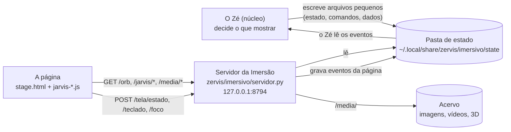

# Como a Imersão funciona e o que dá para personalizar

Cada pessoa quer o Zé de um jeito: outras cores, outro avatar, cenas no seu estilo, outras
frases. Este guia explica como a Imersão funciona hoje, o que já é **dado** (JSON, Markdown)
e pode mudar sem mexer em código, o que ainda está **no código**, e como a comunidade pode
contribuir de forma segura.

## 1. As peças



- **O servidor** (`zervis/imersivo/servidor.py`) roda só em `127.0.0.1:8794`, como processo filho
  do Zé, e toda leitura pede o token que a própria página recebe. Ele serve a página e repassa
  arquivos. Não decide nada.
- **A página** (`zervis/imersivo/web/stage.html`) desenha o Zé em 3D (three.js), lê as mãos pela
  câmera (MediaPipe, no próprio navegador; a câmera nunca sai da máquina) e carrega um script por
  função:

  | Script | O que faz |
  |---|---|
  | `jarvis-avatar.js` | o Zé em 3D (o chimpanzé holográfico) ou o anel |
  | `jarvis-cenas.js` | as cenas que o Zé escreve ("me explica X") |
  | `jarvis-holograma.js` | hologramas 3D montados com peças |
  | `jarvis-mapas.js` | mapas de verdade (IBGE e Natural Earth) |
  | `jarvis-apresentacao.js` | o Zé vai para o canto e os painéis aparecem |
  | `jarvis-andamento.js` | a barra de carregamento no topo |
  | `jarvis-tema.js` e `jarvis-tema.css` | as cores |
  | `jarvis-fundo.js` | o fundo: a câmera ou escuro |
  | `jarvis-config.js` | o menu de configurações (tecla D) |
  | `jarvis-controle.js` | executa os comandos do Zé e devolve o estado da tela |
  | `jarvis-maos.js` | a pinça, o brilho da câmera e a calibração |
  | `jarvis-cerebro.js`, `jarvis-grafo.js`, `jarvis-paineis.js` | o cérebro navegável e os painéis |
  | `jarvis-teclado.js` | o teclado para escrever para o Zé |

- **O Zé** nunca fala com a página direto. Ele escreve arquivos pequenos na pasta de estado, e a
  página lê pelo servidor. Se o Zé parar, a página continua de pé e só fica parada.

### Os canais, um por um

| Arquivo (pasta de estado) | Quem escreve | Para quê |
|---|---|---|
| `state` | o Zé | uma palavra: `idle`, `listening`, `thinking`, `speaking` |
| `mood.json` | o Zé | o humor do anel: `green`, `amber`, `red` |
| `wave.json` | o Zé | a onda da voz enquanto fala (64 amostras) |
| `expressao.json` | o Zé | o rosto do avatar: alegria, dúvida, raiva, tristeza |
| `andamento.json` | o Zé | o passo atual e o tempo esperado, para a barra (ADR 0064) |
| `tela-comando.json` | o Zé | os comandos: abrir, zoom, tema, uma cena… |
| `tela-estado.json` | a página | o que está na tela e os eventos (um clique, um gesto) |
| `mapa.json`, `trabalho.json`, `foco.json`, `orbes.json`… | o Zé | os dados dos painéis |
| `maos-perfil.json` | a página | a calibração das suas mãos |

Um comando é um JSON com uma lista de ações, por exemplo:

```json
{"id": "p42", "ts": 1793800000, "acoes": [
  {"acao": "visual", "valor": "avatar"},
  {"acao": "explicar", "cena": {"titulo": "...", "passos": []}}
]}
```

As ações de hoje são `abrir`, `buscar`, `fechar`, `abrir_mapa`, `fechar_mapa`, `modo`, `focar`,
`localizar`, `zoom`, `enquadrar`, `mover`, `rolar`, `voltar`, `aguardar`, `menu`, `teclado`,
`foco`, `visual`, `girar`, `tema`, `brilho`, `expressao`, `calibrar_maos`, `maos_padrao`,
`apresentar` e `explicar`. A lista e as regras de cada uma ficam em `zervis/rosto/tela.py`.

## 2. O que já é dado (JSON e Markdown)

### As cenas: o melhor exemplo
Quando você pede "me explica como funciona um RAG", o cérebro **não escreve código**. Ele escreve um
**JSON de cena**, e a página desenha esse JSON com um catálogo fixo de blocos. Dá para testar,
guardar, compartilhar e versionar uma cena como qualquer arquivo:

```json
{
  "titulo": "Como funciona um RAG",
  "passos": [
    {"fala": "Primeiro, os documentos viram pedaços pequenos.",
     "blocos": [{"tipo": "etapas", "etapas": ["Documentos", "Pedaços", "Vetores"]}]},
    {"fala": "Na pergunta, eu busco os pedaços mais parecidos.",
     "blocos": [{"tipo": "rede", "nos": ["Pergunta", "Busca", "Pedaços", "Resposta"]}]},
    {"fala": "Com isso, a resposta vem com a fonte.", "limpar": true,
     "blocos": [{"tipo": "comparar", "lados": [
       {"nome": "Sem RAG", "itens": ["Responde de memória"]},
       {"nome": "Com RAG", "itens": ["Responde com a fonte"]}]}]}
  ]
}
```

São **18 tipos de bloco**: `titulo`, `numero`, `barras`, `linha`, `rosca`, `etapas`, `rede`, `onda`,
`forma3d`, `globo`, `comparar`, `lista`, `holograma`, `modelo`, `mapa`, `linha_tempo`, `foto` e
`video`. O esquema de cada bloco, com os campos e os limites, está na
ferramenta `tela_explicar` (`zervis/cerebro/ferramentas/tela.py`). A página confere cada campo
antes de desenhar (`TIPOS`, em `jarvis-cenas.js`): campo errado é descartado, nunca executado.

### Outros dados que já mudam sem código

| O quê | Onde | Formato |
|---|---|---|
| As telas do Núcleo (Mapa, Guia, Acervo…), com apelidos falados | `barehands.json` (exemplo em `docs/imersivo/barehands.json.example`) | JSON |
| Os contornos dos mapas | `zervis/imersivo/web/jarvis-mapas.json`, gerado por `zervis/imersivo/gerar_mapas.py` | JSON |
| Fotos, vídeos e modelos 3D, com crédito e licença | o Acervo (`~/.local/share/zervis/acervo`), um `.json` ao lado de cada arquivo | arquivos e JSON |
| As suas escolhas na tela (fundo, cores, visual, brilho) | o navegador (`localStorage`) | chave e valor |
| A calibração das mãos | `maos-perfil.json` | JSON |

Fora da Imersão, também já são dados: a **persona** (`zervis/persona/ZE.md`, Markdown), as
**skills** (`SKILL.md`, no padrão aberto agentskills.io), o **perfil** (`perfil.json`), as
escolhas de **voz**, **fala** e **escuta** (`voz.json`, `fala.json`, `escuta.json`,
`chamado.json`), as **Respostas rápidas** (`via-rapida.json`), os **conectores**
(`mcp-painel.json`) e a configuração geral (`config.toml`), todos em `~/.config/zervis` ou
`~/.local/state/zervis`.

## 3. O que ainda está no código (e poderia virar JSON)

| O quê | Onde está hoje | Candidato a JSON? | Cuidado |
|---|---|---|---|
| **Temas** (as cores do anel, do grafo, dos painéis) | `TEMAS` em `jarvis-tema.js` e as variáveis `--jv-*` em `jarvis-tema.css` | **Sim, o mais fácil.** Um tema é só um nome e uma lista de cores | contraste mínimo para o texto continuar legível |
| **Avatar** (o modelo 3D, a constelação de pontos) | `avatar/jarvis-chimpanze.glb` e `jarvis-avatar.js` | **Sim**: o arquivo `.glb` e um JSON com escala, posição e cores | tamanho do arquivo; a boca e as expressões dependem dos nomes das partes do modelo |
| **Layout das cenas** (onde ficam os blocos, o tamanho do Zé no canto) | `AREA` em `jarvis-cenas.js` e `paraOCanto` em `jarvis-apresentacao.js` | Sim, por preset ("compacto", "cinema") | telas pequenas e o celular |
| **Estilo dos blocos** (vidro, brilho, varredura) | `jarvis-cenas.css` | Em parte: variáveis de CSS por tema | — |
| **Receitas de cena** (uma cena pronta para um assunto que se repete) | não existe | **Sim**: o mesmo JSON de cena, guardado com um nome ("minha apresentação comercial") | dados reais com fonte; números sem fonte levam "ilustrativo" |
| **Rótulos da barra de carregamento** | `ROTULOS` em `zervis/rosto/andamento.py` | Sim | — |
| **Frases de espera** ("Só um momento", "Um instante") | `AVISOS` em `zervis/cerebro/rapido.py` | Sim, uma lista por idioma ou estilo | frases curtas, para não atrasar a resposta |
| **Atalhos de teclado** | `ATALHOS` em `jarvis-config.js` e os tratadores de tecla | Sim | conflito com atalhos do sistema |
| **Comandos falados sem o cérebro** ("muda para o Claude", "aumenta o brilho") | `zervis/nucleo/estados.py` | Em parte: os sinônimos, sim; a lógica, não | falsos positivos na fala |

**O que não deve virar JSON** é o que protege você: as travas de rede, as regras de aprovação
falada, os limites de tamanho e o que a página aceita de cada bloco. Isso continua no código,
testado.

## 4. Como a comunidade pode contribuir

### Hoje, com código (por PR)
- **Um tipo de bloco de cena novo**:
  1. o validador em `TIPOS` e o desenho em `BLOCOS` (`jarvis-cenas.js`);
  2. o estilo em `jarvis-cenas.css`;
  3. o campo no esquema da ferramenta `tela_explicar`;
  4. um teste em `tests/imersivo/`.
- **Um tema**: uma entrada em `TEMAS` (`jarvis-tema.js`).
- **Rodar os testes da Imersão**: `make check-imersivo` (Chromium sem tela, a página de verdade).

Regras do projeto: [CONTRIBUTING.md](../../CONTRIBUTING.md) e [docs/06-qualidade.md](../06-qualidade.md).

### A proposta: pacotes de Imersão, só de dados
Quando o Zé estiver em versões estáveis, a ideia é que a comunidade possa compartilhar
**personalizações sem código**: uma pasta com um `pacote.json` e os arquivos dele, instalada pelo
painel com a sua aprovação, como os pacotes de skills e conectores da
[ADR 0033](../adr/0033-pacotes-de-extensao.md).

```json
{
  "nome": "tema-neon",
  "versao": "1.0.0",
  "autor": "alguem",
  "licenca": "CC-BY-4.0",
  "tipo": "tema",
  "tema": {
    "nome": "Neon",
    "acento": "#ff3df5",
    "anel": {"idle": [255, 61, 245], "thinking": [255, 140, 250]},
    "grafo": ["#ff7af8", "#ffc2fb"]
  }
}
```

Os tipos de pacote previstos são `tema`, `avatar` (o `.glb` e o JSON de ajuste), `layout`,
`receitas` (cenas prontas) e `frases`. As regras, para continuar seguro:

1. **Só dados, nunca código.** Nada de JavaScript, Python ou CSS livre vindo de pacote. A página
   lê o JSON e aplica pelos mesmos validadores de hoje. É a essência do Zé: nada de código de
   terceiros dentro dele ([docs/essencia.md](../essencia.md)).
2. **Esquema conferido** antes de instalar: campo desconhecido é recusado; cor, número e texto
   com limite.
3. **Arquivos conferidos**: tipo pelo conteúdo, não pelo nome; tamanho máximo; SHA-256 guardado.
4. **Aprovação na tela**, mostrando o que o pacote muda, e **remoção sem rastro**.
5. **Versão fixada**: atualizar é instalar de novo, vendo o que muda.

O primeiro passo para chegar lá é tirar do código os **temas**, que já são quase só dados.
Depois vêm as receitas de cena, o layout e o avatar. Cada passo é uma decisão registrada em
[docs/adr](../adr/), com testes.
